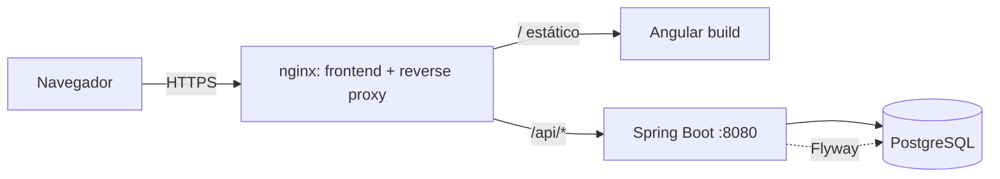

# Arquitectura de JobTrack

Monolito modular: SPA Angular + API REST Spring Boot + PostgreSQL. Sin microservicios.

## Versiones (verificadas el 2026-10-19)

| Componente | Versión | Motivo |
|---|---|---|
| Java | 21 (LTS) | Requisito; Spring Boot 4 lo soporta |
| Spring Boot | 4.1.1 | Última estable de la rama 4.x (3.5 ya sin soporte OSS) |
| Maven | 3.9 (wrapper) | |
| PostgreSQL | 16 | Imagen `postgres:16-alpine` |
| Node.js | 24 LTS | Requerido por Angular CLI 22 (`^22.22.3 \|\| ^24.15.0`) |
| Angular | 22.2 | Última estable; standalone + signals |

## Vista general



El navegador habla con **un solo origen**. nginx sirve la SPA y reenvía `/api` al backend. Consecuencias:
sin CORS en producción, cookies `SameSite=Lax` suficientes y CSRF sencillo. En desarrollo, `ng serve` usa
`proxy.conf.json` hacia `localhost:8080` para conservar el mismo modelo.

## Backend: paquetes por funcionalidad

```
com.jobtrack
├── common/      errores (ProblemDetail), utilidades
├── config/      SecurityConfig, OpenApiConfig
├── auth/        registro, login, logout, /me, cambio de contraseña
├── user/        entidad User, repositorio
├── offer/       ofertas, filtros, historial de estados, CSV
├── profile/     perfil profesional
├── compatibility/ algoritmo determinista (sin dependencias de Spring)
└── stats/       agregados para dashboard y estadísticas
```

Capas dentro de cada paquete: `Controller` → `Service` → `Repository` + `Entity`; DTOs como `record`.
El `userId` **siempre** sale del `SecurityContext`, nunca del cliente; todos los repositorios filtran por `userId`.

## Autenticación (decisión)

Sesión de servidor con cookie `JSESSIONID` (HttpOnly, `SameSite=Lax`, `Secure` en producción), almacenada en
PostgreSQL con Spring Session JDBC (sobrevive a reinicios). CSRF mediante cookie `XSRF-TOKEN` legible por Angular, que
reenvía la cabecera `X-XSRF-TOKEN` automáticamente. Nada sensible en `localStorage`. Contraseñas con BCrypt.

```mermaid
sequenceDiagram
  participant A as Angular
  participant S as Spring
  A->>S: GET /api/v1/auth/me (401 si no hay sesión; fija cookie XSRF-TOKEN)
  A->>S: POST /api/v1/auth/login {email,password} + X-XSRF-TOKEN
  S-->>A: 200 + Set-Cookie JSESSIONID (sesión regenerada)
  A->>S: GET /api/v1/offers (cookie)
  A->>S: POST /api/v1/auth/logout
  S-->>A: 204 (sesión invalidada)
```

## Decisiones técnicas

| # | Decisión | Alternativa descartada | Razón |
|---|---|---|---|
| 1 | Sesión + cookie | JWT en localStorage | Evita exponer tokens a XSS; revocación trivial |
| 2 | nginx como proxy único | CORS abierto | Superficie menor, cookies más simples |
| 3 | Compatibilidad persistida en `job_offers.compatibility_score` | Cálculo en lectura | Permite ordenar y paginar en BD; se recalcula al guardar oferta o perfil |
| 4 | Gráficos SVG propios | Chart.js | Sin dependencias; solo 3 tipos de gráfico |
| 5 | Iconos SVG inline propios | Librería de iconos | Pocos iconos necesarios |
| 6 | Spring Session JDBC | Sesión en memoria | Sesiones tras reinicio del contenedor |
| 7 | UUID como id público | Secuencias | Evita enumeración de recursos |
| 8 | Flyway con `ddl-auto=validate` | Hibernate DDL | Esquema versionado y reproducible |
| 9 | Testcontainers (PostgreSQL real) | H2 | H2 oculta diferencias con PostgreSQL |

## Entornos

- `dev`: backend en 8080, Angular en 4200 con proxy, cookie no `Secure`.
- `prod`: perfil Spring `prod`, cookie `Secure`, OpenAPI/Swagger deshabilitado por defecto, sin datos demo.
