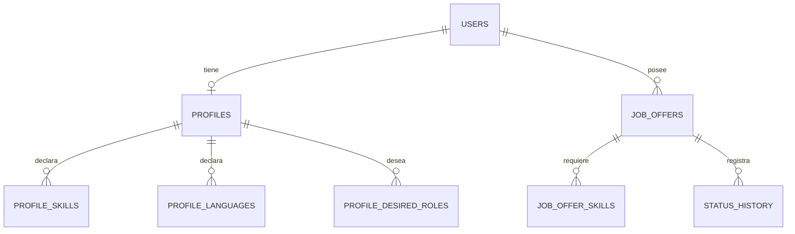

# Modelo de datos

Esquema gestionado exclusivamente por Flyway (`backend/src/main/resources/db/migration`). Hibernate solo valida.

## Tablas

**users**: `id uuid PK`, `email varchar(254)` único (guardado en minúsculas), `display_name`, `password_hash` (BCrypt), `created_at`.

**profiles** (1:1 con users, `user_id` PK/FK, `ON DELETE CASCADE`): `degree`, `experience_summary`, `years_experience numeric(4,1) NULL`,
`location`, `preferred_work_mode NULL` (REMOTE|HYBRID|ON_SITE; NULL = sin preferencia), `expected_salary NULL`, `salary_currency`,
`preferences`, `updated_at`.
- `profile_skills(user_id, name)` — PK compuesta; `profile_languages(user_id, language, level)`; `profile_desired_roles(user_id, role)`.

**job_offers**: `id uuid PK`, `user_id FK`, `title`, `company`, `description`, `url`, `location`, `work_mode NULL`,
`published_date NULL`, `detected_date` (por defecto hoy), `applied_date NULL`, `salary_min NULL`, `salary_max NULL`
(`CHECK salary_min <= salary_max`, ambos `>= 0`), `currency NULL`, `contract_type NULL`, `working_hours NULL`,
`min_years_experience NULL`, `requirements`, `notes`, `status` (enum), `favorite bool`, `compatibility_score smallint NULL`
(`0..100`, NULL = información insuficiente), `created_at`, `updated_at`.
- `job_offer_skills(offer_id, name)` — PK compuesta.
- Índices: `(user_id, status)`, `(user_id, favorite)`, `(user_id, detected_date)`, `(user_id, lower(company))`, `(user_id, compatibility_score)`.

**status_history**: `id uuid PK`, `offer_id FK ON DELETE CASCADE`, `user_id FK`, `from_status NULL`, `to_status`, `changed_at timestamptz`, `note`.
Sólo se inserta desde el servicio (el cliente nunca envía `from_status` ni `changed_at`). Creación de la oferta genera la primera fila (`NULL → estado inicial`).

**spring_session / spring_session_attributes**: tablas estándar de Spring Session JDBC.

## Convenciones sobre «desconocido»

- Campos opcionales usan `NULL` para «no informado». `0` es un valor real (p. ej. `min_years_experience = 0`: «no requiere experiencia»).
- `work_mode NULL` = desconocido, no «presencial».
- `compatibility_score NULL` = información insuficiente, no 0.

## Estados

`SAVED`, `PENDING_TO_APPLY`, `APPLIED`, `IN_PROCESS`, `INTERVIEW`, `OFFER_RECEIVED`, `REJECTED`, `WITHDRAWN`.
Se permite cualquier transición salvo a sí mismo (la vida real no es lineal: se puede rechazar sin haber solicitado, o reabrir un proceso).
Al pasar a `APPLIED`, si `applied_date` es NULL se fija a la fecha actual.
