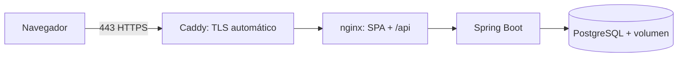

# Guía de despliegue (VPS con HTTPS)

Hay dos variantes, según quién termine el TLS en el servidor:

- **Caddy propio** (`compose.prod.yaml`): un VPS dedicado a JobTrack. Caddy ocupa los puertos 80/443.
- **Traefik compartido** (`compose.traefik.yaml`): un VPS con varios proyectos y un Traefik ya instalado. Ver [Variante con Traefik](#variante-con-traefik-compartido).

## Arquitectura



Caddy obtiene y renueva certificados de Let's Encrypt automáticamente. nginx y el backend no están expuestos a Internet.

## Requisitos

VPS Linux con Docker y Docker Compose v2, un dominio con registro `A`/`AAAA` apuntando al servidor y puertos 80/443 abiertos.

## Pasos

```bash
git clone <tu-repositorio> jobtrack && cd jobtrack
cp .env.example .env
# Edita .env:
#   POSTGRES_PASSWORD=<valor largo y aleatorio: openssl rand -base64 24>
#   JOBTRACK_SECURE_COOKIES=true
#   JOBTRACK_BIND=127.0.0.1
#   JOBTRACK_DOMAIN=jobtrack.tu-dominio.com
docker compose -f compose.yaml -f compose.prod.yaml up -d --build
docker compose -f compose.yaml -f compose.prod.yaml ps      # todo "healthy"
curl -I https://jobtrack.tu-dominio.com
```

## Variante con Traefik compartido

Para un VPS donde Traefik ya publica 80/443 y enruta por etiquetas Docker (red externa `web`). No se usa Caddy: `compose.traefik.yaml` conecta el frontend a la red `web`, declara el router y el certificado (resolver `letsencrypt`) y añade HSTS y un límite de frecuencia al registro (`/api/v1/auth/register`, 5/min por IP, que la app no limita por sí misma).

```bash
mkdir -p ~/apps/jobtrack && cd ~/apps/jobtrack     # código del repositorio dentro
cp .env.example .env && chmod 600 .env
# Edita .env:
#   POSTGRES_PASSWORD=<openssl rand -hex 24>
#   JOBTRACK_SECURE_COOKIES=true
#   JOBTRACK_BIND=127.0.0.1                  # el puerto publicado queda solo en loopback
#   JOBTRACK_HTTP_PORT=18080                 # evita chocar con otros proyectos del servidor
#   JOBTRACK_DOMAIN=jobtrack.tu-dominio.com  # con un registro DNS (o comodín *.) hacia el VPS
docker compose -f compose.yaml -f compose.traefik.yaml build backend    # uno a uno: dos compilaciones a la vez
docker compose -f compose.yaml -f compose.traefik.yaml build frontend   # pueden agotar la RAM de un VPS pequeño
docker compose -f compose.yaml -f compose.traefik.yaml up -d
```

Notas:

- **Memoria**: el override limita los contenedores (BD 384 MB, backend 640 MB, nginx 64 MB) para no competir con el resto de proyectos; el heap de la JVM se ajusta al límite del backend.
- **Alias de red**: nginx llega al backend por el alias `jobtrack-backend`, no por `backend`. Los proyectos que siguen la plantilla de la infraestructura también tienen un servicio `backend` en la red `web`, y el nombre genérico podría resolver al contenedor de otro proyecto.
- **Actualizar**: sustituye el código (por ejemplo `git archive HEAD | ssh vps 'tar -x -C ~/apps/jobtrack'`) y repite `build` + `up -d`. Los datos viven en el volumen `jobtrack_db-data` y sobreviven.
- **Copias y logs**: igual que abajo, con `-f compose.yaml -f compose.traefik.yaml`.

## Operación

- **Migraciones**: Flyway las aplica al arrancar el backend (`V1__…`, `V2__…`). Son solo de avance; nunca edites una migración ya aplicada, crea una nueva.
- **Copias de seguridad**: `docker compose exec -T db pg_dump -U jobtrack jobtrack | gzip > backup-$(date +%F).sql.gz`. Restaurar: `gunzip -c backup.sql.gz | docker compose exec -T db psql -U jobtrack jobtrack`. Programa la copia con cron y guárdala fuera del servidor.
- **Actualizar**: `git pull && docker compose -f compose.yaml -f compose.prod.yaml up -d --build`.
- **Logs**: `docker compose logs -f backend`.
- **Cortafuegos**: permite solo 22, 80 y 443. La BD escucha solo en `127.0.0.1`.

## Lista de comprobación previa a producción

- [ ] `JOBTRACK_SECURE_COOKIES=true` y acceso solo por HTTPS.
- [ ] `POSTGRES_PASSWORD` única y larga; `.env` con permisos `600`.
- [ ] Swagger inactivo (`/swagger-ui.html` → 404) y `/actuator/*` → 404 desde Internet.
- [ ] Copia de seguridad programada y restauración probada.
- [ ] Revisados los [límites conocidos](security-and-config.md#límites-conocidos) (registro abierto, limitador en memoria).
