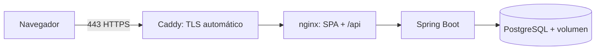

# Guía de despliegue (VPS con HTTPS)

Documentada y preparada, **no ejecutada**: no se ha desplegado en ningún servidor ni se ha contratado ningún servicio.

## Arquitectura



Caddy obtiene y renueva certificados de Let's Encrypt automáticamente. nginx y el backend no están expuestos a Internet.

## Requisitos

VPS Linux con Docker y Docker Compose v2, un dominio con registro `A`/`AAAA` apuntando al servidor y puertos 80/443 abiertos.

## Pasos

```bash
git clone <tu-repositorio> jobtrack && cd jobtrack
cp .env.example .env
# Edita .env:
#   POSTGRES_PASSWORD=<valor largo y aleatorio: openssl rand -base64 24>
#   JOBTRACK_SECURE_COOKIES=true
#   JOBTRACK_BIND=127.0.0.1
#   JOBTRACK_DOMAIN=jobtrack.tu-dominio.com
docker compose -f compose.yaml -f compose.prod.yaml up -d --build
docker compose -f compose.yaml -f compose.prod.yaml ps      # todo "healthy"
curl -I https://jobtrack.tu-dominio.com
```

## Operación

- **Migraciones**: Flyway las aplica al arrancar el backend (`V1__…`, `V2__…`). Son solo de avance; nunca edites una migración ya aplicada, crea una nueva.
- **Copias de seguridad**: `docker compose exec -T db pg_dump -U jobtrack jobtrack | gzip > backup-$(date +%F).sql.gz`. Restaurar: `gunzip -c backup.sql.gz | docker compose exec -T db psql -U jobtrack jobtrack`. Programa la copia con cron y guárdala fuera del servidor.
- **Actualizar**: `git pull && docker compose -f compose.yaml -f compose.prod.yaml up -d --build`.
- **Logs**: `docker compose logs -f backend`.
- **Cortafuegos**: permite solo 22, 80 y 443. La BD escucha solo en `127.0.0.1`.

## Lista de comprobación previa a producción

- [ ] `JOBTRACK_SECURE_COOKIES=true` y acceso solo por HTTPS.
- [ ] `POSTGRES_PASSWORD` única y larga; `.env` con permisos `600`.
- [ ] Swagger inactivo (`/swagger-ui.html` → 404) y `/actuator/*` → 404 desde Internet.
- [ ] Copia de seguridad programada y restauración probada.
- [ ] Revisados los [límites conocidos](security-and-config.md#límites-conocidos) (registro abierto, limitador en memoria).
